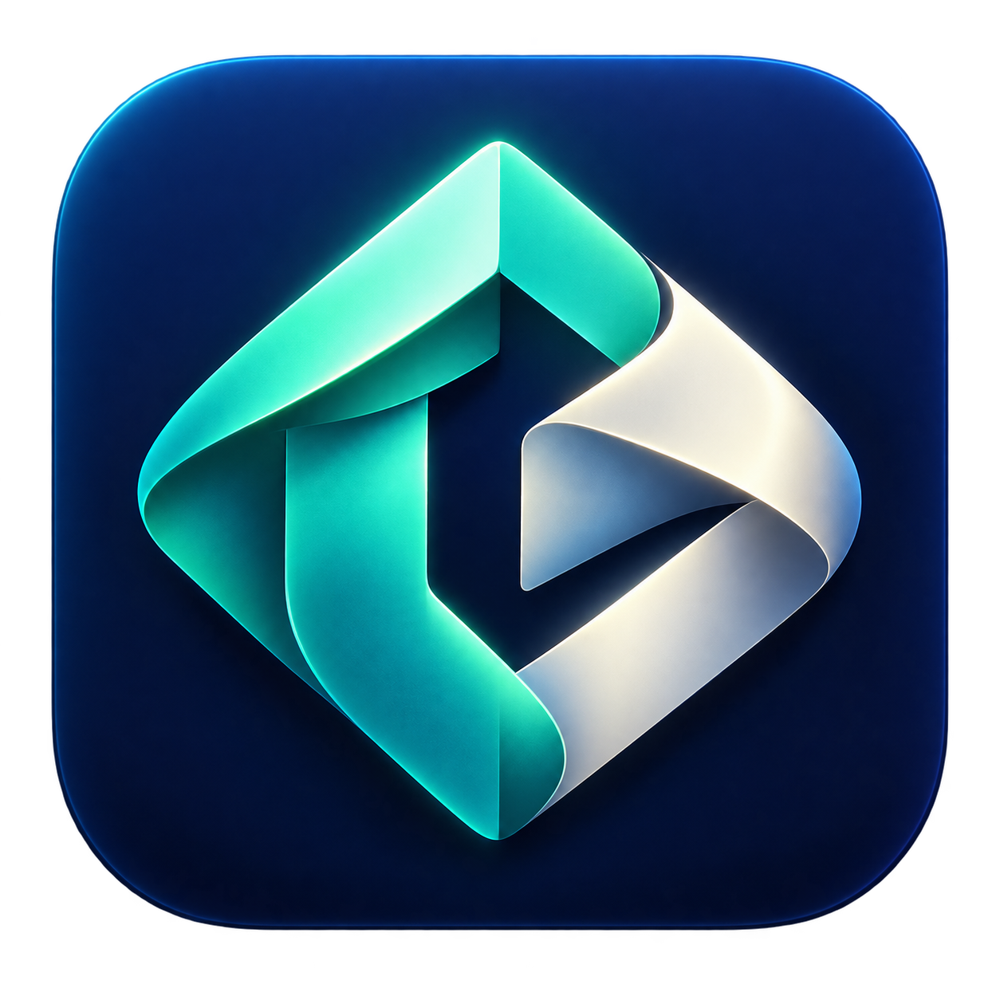
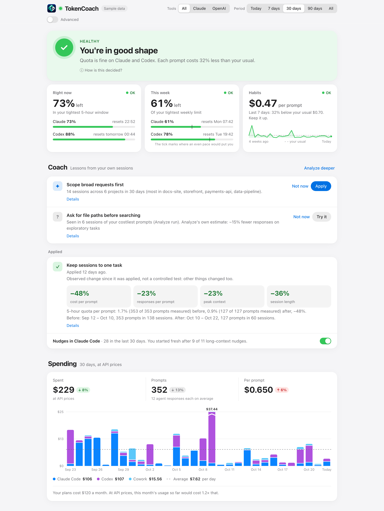
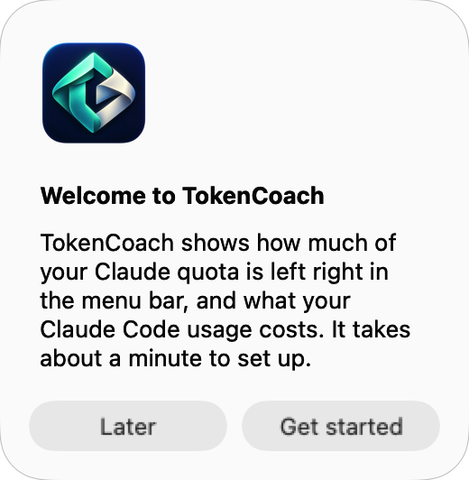
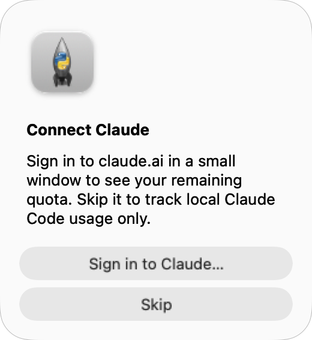
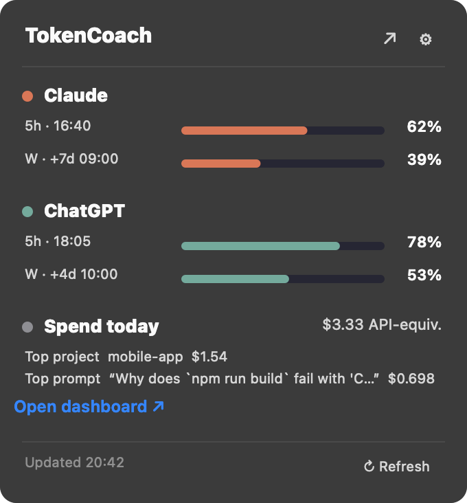
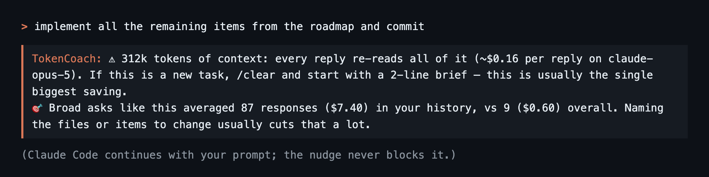
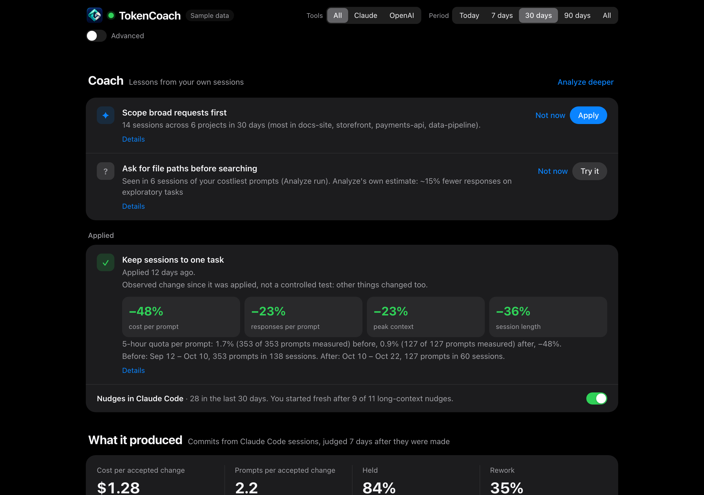
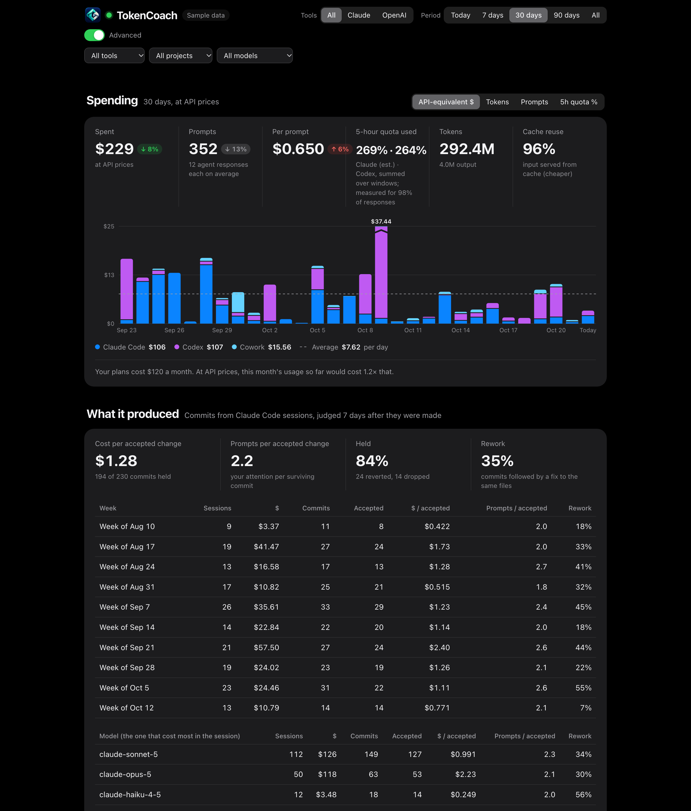

<p align="center">
  
</p>

<h1 align="center">TokenCoach</h1>

<p align="center">
  <b>See what your AI prompts cost. Build better habits.</b>
</p>

<p align="center">
  A macOS menu bar app for Claude Code, Cowork and Codex: quota left, cost per prompt, and coaching on costly habits.
</p>

<p align="center">
  <a href="https://github.com/cagdasatici/TokenCoach/actions/workflows/test.yml"></a>
  <a href="https://github.com/cagdasatici/TokenCoach/releases/latest"></a>
  <a href="#quick-start"></a>
  <a href="LICENSE"></a>
</p>

<p align="center">
  <a href="#quick-start">Quick start</a> &nbsp;·&nbsp;
  <a href="#features">Features</a> &nbsp;·&nbsp;
  <a href="#privacy">Privacy</a> &nbsp;·&nbsp;
  <a href="#faq">FAQ</a> &nbsp;·&nbsp;
  <a href="docs/install.md">Install options</a>
</p>

<p align="center">
  <a href="#quick-start"></a>
</p>

<br>

<p align="center">
  <picture>
    <source media="(prefers-color-scheme: dark)" srcset="docs/images/dashboard-dark.png">
    
  </picture>
  <br>
  <sub><b>Sample data</b> from the built-in demo (<code>tokencoach --demo</code>); all screenshots below use it too.</sub>
</p>

<p align="center">
  <sub>Dollar amounts are API-equivalent costs, not your subscription bill. Claude quota per prompt is an estimate; unmeasured prompts show as unknown.</sub>
</p>

---

## Quick start

You need a Mac with macOS 12 or newer.

1. **Install.** Open Terminal (Cmd+Space, type "Terminal", Return), paste this and press Return:
   ```bash
   curl -fsSL https://raw.githubusercontent.com/cagdasatici/TokenCoach/main/install.sh | bash
   ```
   It checks your Mac, says in plain words if anything is missing (such as Python 3.10+), and takes about a minute.
2. **Look for ◆ in the menu bar**, top right of your screen. Click it any time.
3. **Follow the setup guide** that opens by itself: **Get started**, then **Sign in to Claude…** and log in to
   claude.ai in the small window. Your remaining quota appears in the menu bar.

<p align="center">
  
  &nbsp;
  
</p>

Signing in is optional: without it, TokenCoach still tracks your local Claude Code, Cowork and
Codex usage. Reopen the guide any time from the ⚙ menu → **Setup Guide…**.
More detail: [first-run guide](docs/first-run.md) · Other ways to install (Homebrew, demo only):
[install guide](docs/install.md).

> The one-line installer follows the signed `main` branch. Homebrew ships the stable release,
> **v1.2.0**, which includes the sign-in window, the setup guide and yield tracking.

## Features

A $20–200 subscription feels flat until you hit the 5-hour limit mid-afternoon. The cause is
rarely one big question; it's habits you can't see: long sessions where every reply re-reads
300k tokens of context, broad asks that send an agent on a 100-step tour, or a quick question
sent to the priciest model. TokenCoach makes those visible and helps you change them.

### 1. Measure: every prompt, every token, every project



TokenCoach reads the transcripts that **Claude Code, Cowork and Codex** already write on your
Mac and keeps a local ledger: one row per prompt with tokens, model, project, the cost at API
prices, and its share of your 5-hour quota (estimated for Claude).

The menu bar shows the quota you have **left** for Claude and ChatGPT, today's spend and your
costliest prompt. Percentages turn soft yellow when quota is low or on pace to run out.

**Open dashboard** answers one question first: **healthy, watch or action needed**, from quota
left now, your weekly pace and your habits. Below that: everything by day, project, model and
tool, with an **Advanced** view for the deep dive.

<br clear="right">

### 2. Nudge: a heads-up before an expensive prompt runs



A Claude Code hook adds a one-line tip when it matters, based on *your own* history: a session
re-reading 300k tokens per reply, a broad ask that historically ran 10× longer, a quick question
on your priciest model, or a nearly empty quota. It never blocks or rewrites what you typed, and
you can turn it off in the menu. (Codex has no prompt hook; it gets coaching through `AGENTS.md`.)

### 3. Coach: lessons written into the files your agents read



Patterns that repeat across sessions become **lessons**: plain instructions for your agent such
as *"when a request is broad, list the concrete items and wait for confirmation"*.

- **Evidence decides.** Each lesson says how many separate sessions show the pattern: limited
  (1–2), moderate (3–7) or strong (8+), a rule of thumb rather than a measured accuracy.
- **You stay in control.** Edit any lesson; your wording is never overwritten. Lessons go into one
  marked block in `CLAUDE.md` / `AGENTS.md` after a backup, and **Remove** takes them out again.
- **Improve and Analyze.** Get a tighter rewrite of a costly prompt, or have Claude review your 20
  costliest prompts and propose lessons. Both run only when you click, through your own `claude` CLI.

### 4. Compare: before and after

Every applied lesson shows what changed against the four weeks before: $ per prompt, responses
per prompt, session length, peak context and quota per prompt, with dates and sample sizes. It is
an observed change, not a controlled test, so read it as a hint about which habits pay off.

### 5. Yield: what the spend produced (optional)

Track a git repository and TokenCoach ties each Claude Code session's cost to the commits it made,
then judges them a week later: **cost per accepted change**, **prompts per accepted change** and
**rework**. Set it up with `tokencoach --yield-install ~/code/my-repo`; it adds a
`prepare-commit-msg` hook that never blocks a commit and never replaces a hook that isn't its own.
[How yield is measured](docs/reference.md#yield).

<details>
<summary><b>Advanced view</b>: quota over time, when you work, breakdowns, sessions</summary>
<br>

</details>

---

## FAQ

<details>
<summary><b>Is my Claude login safe?</b></summary>

**Sign in to Claude…** opens a small window that loads `claude.ai/login` in Apple's WebKit, the
engine behind Safari. The window keeps its own claude.ai login in WebKit's storage on your Mac,
separate from your browsers, so signing in again later is usually one click. Once you are signed
in, TokenCoach keeps only three claude.ai cookies (`sessionKey`, `lastActiveOrg`, `routingHint`),
checks them with claude.ai, and saves them in its settings file, which only your macOS user can
read. They are sent only to claude.ai and never written to the log.
Details: [SECURITY.md](SECURITY.md#how-tokencoach-handles-your-logins).
</details>

<details>
<summary><b>Why does macOS ask for permissions?</b></summary>

The sign-in window needs none. Prompts appear only if you choose to reuse your browser's login:

- **Auto-detect from Browser** (⚙ menu) reads the claude.ai / chatgpt.com cookies from your
  browser. For Chrome-family browsers macOS asks for Keychain access to the browser's "Safe
  Storage" key. Click **Allow**, not **Always Allow**: the request can come from Apple's `security`
  tool, and Always Allow would then let any program read that key unasked.
- **Use my browser's login** is offered only in the downloaded TokenCoach.app (not yet published;
  see below). It walks you through macOS's "access data from other apps" prompt and the Keychain
  prompt, and, if macOS still blocks it, points you to Full Disk Access.

Script and Homebrew installs don't offer the guided version: they run as the shared Python, and
granting Python that access would expose your browser cookies to every Python script on your Mac.
</details>

<details>
<summary><b>Does it work with Google sign-in?</b></summary>

Yes. **Continue with Google** opens Google's page in a pop-up inside the sign-in window. Passkeys
don't work in that window: when Google offers one, choose **Try another way** and use your password
or another method. If Google still refuses, the window offers **Use my browser instead**, or use
**Continue with email** on the claude.ai page.
</details>

<details>
<summary><b>Homebrew or downloaded app?</b></summary>

- **One-line installer** (recommended today): the latest signed `main`, with the setup guide and
  sign-in window, start-at-login, auto-update to signed commits, and the optional widget.
- **Homebrew**: the stable v1.2.0 release, updated with `brew upgrade`.
- **Downloaded TokenCoach.app**: packaging exists but the download is deferred and not available
  yet. When it ships, it is the only build that can follow your browser's login after you allow it.

See the [install guide](docs/install.md) for Homebrew, the demo, uninstalling and upgrading.
</details>

<details>
<summary><b>I used AIQuotaBar or AIQuotaLeft. How do I switch?</b></summary>

Run the one-line installer. It stops the old launch agents, watchdog and widget, moves your
settings and quota history into TokenCoach, and removes the old `~/.ai-quota-bar` folder. Your data
is kept. AIQuotaLeft installs that auto-update make this move by themselves on their next start.
</details>

<details>
<summary><b>What do the numbers mean?</b></summary>

Quota percentages show what is **left**. Dollar amounts are what the same tokens would cost on the
provider's API, a yardstick for comparing prompts and models, not a charge on your subscription.
Tokens from Claude Code, Cowork and Codex are exact; Claude quota per prompt is estimated from
quota readings, and "—" means unknown, not zero. Prices are Anthropic and OpenAI list prices
checked 2026-09-27. Full table and price overrides: [reference](docs/reference.md#what-the-numbers-mean).
</details>


## Troubleshooting

- **No ◆ in the menu bar:** `tail -50 ~/Library/Logs/TokenCoach/tokencoach.log`, then
  `bash ~/.tokencoach/tokencoach-doctor.sh` checks and repairs the moving parts.
- **Quota bars empty:** ⚙ menu → **Sign in to Claude…** (or **Setup Guide…**). For ChatGPT, log in
  at chatgpt.com and use **Auto-detect from Browser**, or sign in to the Codex CLI.
- **Dashboard buttons do nothing:** open it from the menu bar; a saved copy is read-only.
- **Empty history:** see [the first-run guide](docs/first-run.md#5-understand-an-empty-or-unavailable-result).
- **Command line:** `tokencoach --help` (Homebrew) or
  `~/.tokencoach/.venv/bin/python ~/.tokencoach/tokencoach.py --help`.

## Privacy

- **Stays on your Mac:** the ledger (including prompt text) is a local SQLite file. The dashboard
  is served only on `127.0.0.1`, behind a per-install key and a Host check.
- **What is read:** Claude Code transcripts (`~/.claude/projects`), Cowork logs, Codex sessions
  (`~/.codex/sessions`), `git log` of repositories you chose to track, and, for the quota bars,
  your claude.ai / chatgpt.com sign-in: from the sign-in window, from your browser if you ask, or
  the Codex CLI's sign-in (`~/.codex/auth.json`, read only).
- **What is sent:** sign-in cookies only to claude.ai / chatgpt.com, to read quota. **Analyze
  deeper** and **Improve** send prompt content to Claude through your own `claude` CLI, only when
  you click, on your Claude plan (TokenCoach removes `ANTHROPIC_API_KEY` from those runs unless you
  set `TOKENCOACH_USE_API_KEY=1`). Installs and updates download code from GitHub and Python packages.
- **What changes on your Mac:** a login agent and watchdog, the Claude Code hook (after a backup of
  `~/.claude/settings.json`), lesson blocks you apply, and git hooks in repositories you track.
  Script installs update only to commits signed by a key in [`allowed_signers`](allowed_signers),
  with hash-pinned dependencies.

Full details: [security and privacy](SECURITY.md).

## Support

Report bugs and questions in [GitHub Issues](https://github.com/cagdasatici/TokenCoach/issues)
with your version (About TokenCoach or `tokencoach --version`), macOS version, install method and
steps to reproduce; see [CONTRIBUTING.md](CONTRIBUTING.md). Never post cookies, dashboard URLs,
prompts, raw logs or personal screenshots. Report vulnerabilities privately via [SECURITY.md](SECURITY.md).
Support is best effort.

## Credits

TokenCoach is built on **[AIQuotaBar](https://github.com/yagcioglutoprak/AIQuotaBar)** by
[Toprak Yagcioglu](https://github.com/yagcioglutoprak). The menu bar app, the quota fetching
for claude.ai and ChatGPT, and the desktop widget all started there. TokenCoach adds the ledger,
dashboard, nudges, coaching and before/after measurement. If you like the menu bar part,
please star the original too.

## License

[MIT](LICENSE). Copyright © 2026 Toprak Yagcioglu (AIQuotaBar) and the TokenCoach contributors.

Not affiliated with or endorsed by Anthropic or OpenAI. The quota bars use the same private
usage endpoints as the providers' own settings pages, and may break when those change.
